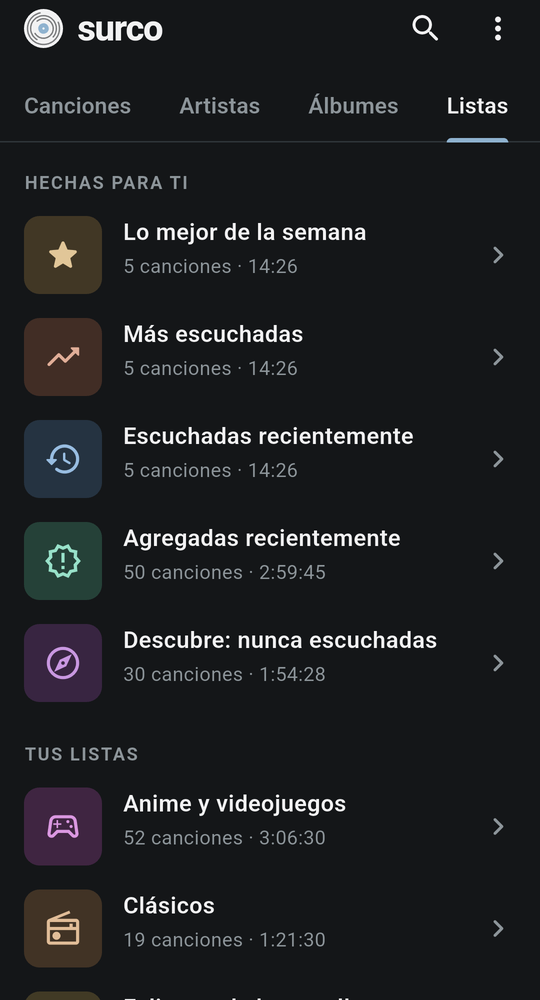
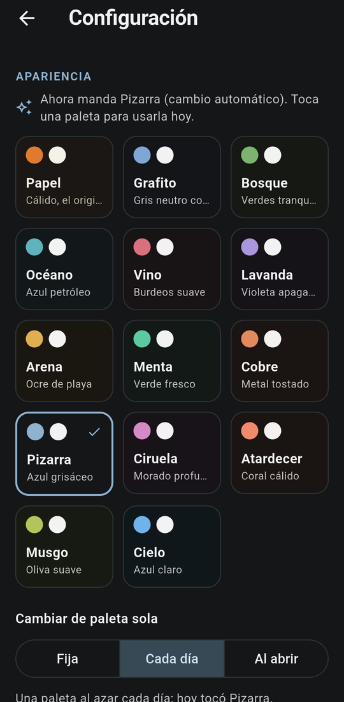

<div align="center">


### Reproductor de música local para Android: ligero, sobrio y sin cuentas ni anuncios.

**Tu música, en tu teléfono, con su portada y su letra.**<br/>
**Estadísticas y listas que se arman solas, sin que nada salga del dispositivo.**

<br/>

<a href="https://github.com/Mickaell22/surco/releases/latest/download/surco-arm64-v8a.apk"></a>

<br/><br/>

[](https://github.com/Mickaell22/surco/releases/latest)
[](https://github.com/Mickaell22/surco/releases)
[](https://flutter.dev)
[](#descargar)
[](./LICENSE)

[](#funciones)
[](#estadísticas-y-listas-automáticas)
[](#temas)
[](#por-qué-es-ligera)

<br/>

[Descargar](#descargar) • [Funciones](#funciones) • [Temas](#temas) • [Poner tu música](#poner-tu-música) • [Privacidad](#privacidad) • [Desarrollo](#desarrollo)

<br/>


&nbsp;&nbsp;


</div>

---

## Descargar

Baja el APK de la [última versión](https://github.com/Mickaell22/surco/releases/latest):

| Archivo | Para |
|---|---|
| [`surco-arm64-v8a.apk`](https://github.com/Mickaell22/surco/releases/latest/download/surco-arm64-v8a.apk) | casi todos los teléfonos actuales |
| [`surco-armeabi-v7a.apk`](https://github.com/Mickaell22/surco/releases/latest/download/surco-armeabi-v7a.apk) | teléfonos antiguos de 32 bits |
| [`surco-x86_64.apk`](https://github.com/Mickaell22/surco/releases/latest/download/surco-x86_64.apk) | emuladores |

Los enlaces bajan siempre la versión más reciente; las anteriores y sus cambios están en [Releases](https://github.com/Mickaell22/surco/releases) y en el [CHANGELOG](./CHANGELOG.md). Requiere Android 5.0 o superior. Android te pedirá permitir "instalar apps de origen desconocido" la primera vez. `SHA256SUMS.txt` en cada release permite verificar los archivos.

## Funciones

- **Biblioteca** de canciones, artistas, álbumes y listas `.m3u`, con búsqueda.
- **Ordenar** por título, artista, agregadas recientemente, más escuchadas o duración.
- **Letra** embebida en el archivo. Si es sincronizada (LRC) resalta la línea que suena; tocar una línea salta ahí.
- **Segundo plano** con notificación, pantalla de bloqueo y botones de audífonos Bluetooth.
- **Cola** editable, reproducir a continuación, aleatorio, repetir (todo o una) y temporizador de apagado.
- **Retomar** la última cola y posición al abrir la app.
- **Pausar** al desconectar los audífonos (cable o Bluetooth), para que la música no salga por el parlante.
- **Saltar silencios** largos al inicio y final de las pistas.

## Estadísticas y listas automáticas

Surco cuenta una escucha con la regla de Last.fm: cuando la oyes hasta **la mitad o 4 minutos**, lo que llegue primero. Saltar una canción que no te gusta no suma, y adelantar con la barra no infla el tiempo (se mide lo que de verdad sonó). Con eso muestra:

- Tiempo escuchado, número de escuchas y canciones distintas en 7 días, 30 días o desde siempre.
- Minutos por día de la semana.
- Top de canciones y de artistas.

Y arma solas las listas **Lo mejor de la semana**, **Más escuchadas**, **Escuchadas recientemente**, **Agregadas recientemente** y **Descubre** (canciones que nunca escuchaste, distintas cada día). Cada lista, tuya o automática, lleva un ícono y un tono propios según su nombre (entrenar, tristes, anime, rock...) para reconocerla de un vistazo.

## Temas

Catorce paletas sobrias: **Papel** (cálida, la original), **Grafito**, **Bosque**, **Océano**, **Vino**, **Lavanda**, **Arena**, **Menta**, **Cobre**, **Pizarra**, **Ciruela**, **Atardecer**, **Musgo** y **Cielo**. Cada una con modo claro, oscuro o según el sistema, y **negro puro** opcional para pantallas AMOLED.

La paleta puede quedarse **fija**, cambiar **cada día** (estable durante el día, nunca igual a la de ayer) o cambiar **cada vez que abres Surco** (nunca la misma seguida). Tocar una paleta mientras manda algo automático la aplica solo por hoy.

**Temas de temporada** (se pueden desactivar): en sus fechas la app se viste sola, con decoraciones dibujadas (telarañas, luces, papel picado, confeti...) y un pequeño ícono junto al logo. La primera vez que abres Surco ese día sale el tema de la temporada; las siguientes, el cambio automático que elegiste.

| Temporada | Fechas |
|---|---|
| Halloween | 15–31 de octubre |
| Día de Muertos | 1–2 de noviembre |
| Navidad | 1–25 de diciembre |
| Año Nuevo | 26 de diciembre – 6 de enero |
| San Valentín | 7–15 de febrero |
| Carnaval | sábado a martes antes del Miércoles de Ceniza (cambia cada año) |
| San Patricio | 17 de marzo |
| Día de la Tierra | 22 de abril |
| Día de la Madre | segundo domingo de mayo y el sábado anterior |
| Día del Padre | tercer domingo de junio y el sábado anterior |
| Inti Raymi | 20–24 de junio |
| Tu cumpleaños | el día que elijas en Configuración (todo el día) |

## Poner tu música

1. Copia tus archivos (MP3, M4A, FLAC, OGG, Opus o WAV) a la carpeta `Music` o `Download` del teléfono.
2. Abre Surco y da permiso de acceso a archivos de audio.
3. Para listas propias, deja archivos `.m3u` junto a tu música, con una ruta por línea (relativa al `.m3u` o absoluta).

Por defecto solo busca en `Music` y `Download` e ignora audios de menos de 30 segundos y carpetas como WhatsApp, grabaciones, tonos y notificaciones. En Configuración se puede ampliar a todo el teléfono.

## Privacidad

Surco no tiene cuentas, anuncios, analítica ni conexión a internet. La biblioteca, las estadísticas y la configuración se guardan solo en el teléfono, y "Borrar historial de escuchas" en Configuración elimina las estadísticas.

## Por qué es ligera

- Pocas dependencias: `just_audio` (+ `just_audio_background`), `audio_session`, `audio_metadata_reader` (Dart puro), `permission_handler`, `path_provider`.
- Tipografía del sistema; no descarga fuentes.
- Las portadas se extraen una vez a caché en disco y se decodifican al tamaño de la miniatura.
- El escaneo corre en un isolate y solo relee archivos nuevos o modificados.
- La letra se lee del archivo solo al abrirla.

## Desarrollo

```bash
flutter pub get
flutter test
flutter build apk --release --split-per-abi
```

- **Firma de release**: crea `android/key.properties` (ignorado por git) con `storeFile`, `storePassword`, `keyAlias` y `keyPassword`. Sin ese archivo el build release usa la llave de debug.
- **Ícono**: `python3 tool/make_icon.py` (requiere Pillow) regenera los íconos del launcher y `docs/logo.png` a partir del mismo dibujo que `SurcoMark`.
- **Versiones fijadas**: `pubspec.yaml` fija `permission_handler_android` y `audio_session` a versiones compatibles con el AGP 8.11 de Flutter 3.38; las más nuevas exigen AGP 9.

## Licencia

[MIT](./LICENSE) © 2026 Mickaell. Puedes usar, modificar y redistribuir el código manteniendo el aviso de licencia.

<div align="center">
<br/>

<br/><sub>Surco: el surco del vinilo, donde vive la música.</sub>
</div>
